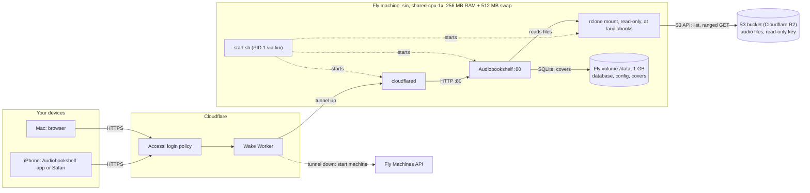
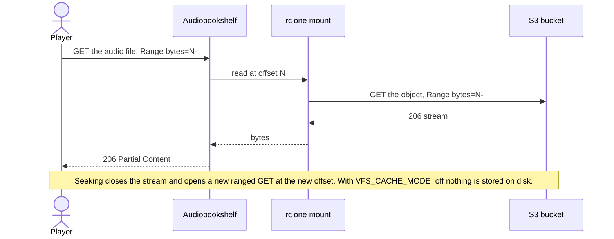

# Audiobookshelf on Fly.io, with audiobooks in S3

This repo runs [Audiobookshelf](https://github.com/advplyr/audiobookshelf) on a small Fly.io machine. Your audiobooks stay in an S3 bucket and are never copied to the server. The app is private: it sits behind a Cloudflare Tunnel and a Cloudflare Access login, and the machine sleeps when you aren't using it.

## How it fits together

- **Audio stays in S3.** The bucket is mounted read-only at `/audiobooks`, so Audiobookshelf reads files as if they were on disk. Audio is streamed from S3 when played and is not stored on the server.
- **The server keeps only small files.** Audiobookshelf's database, settings, and cover images live on a 1 GB Fly volume at `/data`.
- **Access is private.** The app has no public address. A Cloudflare Tunnel runs in the same container, and Cloudflare Access asks you to log in before it lets a request through.
- **It sleeps when idle.** After 15 minutes with nobody connected the machine stops. The next visit to your link wakes it. See [Sleep when idle](#sleep-when-idle).

```
Fly machine
├── tini                              process manager (PID 1)
└── start.sh
    ├── rclone lsf                    checks the bucket, endpoint, and key
    ├── rclone mount (read-only)      S3 bucket  ->  /audiobooks
    ├── cloudflared                   tunnel to Cloudflare, forwards your hostname to port 80
    ├── node dist-server/index.js     Audiobookshelf
    └── idle watcher                  stops the machine after IDLE_STOP_MINUTES with no connections
```

### Why a mount instead of copying or symlinks

- **Copying the bucket at boot** would make startup slower as the library grows, and the volume would need to be as large as the whole library.
- **A symlink can't point at S3 on its own.** Something has to present the bucket as a filesystem. FUSE does that, so one mount covers the whole bucket and no per-file links are needed.
- **A mount starts fast.** Files are fetched only when they are read, and the volume holds only the database and covers.

### Safety

- **Read-only.** The mount is read-only and the S3 key only needs read access. Audiobookshelf can't change or delete your books.
- **Fail-fast.** If the endpoint, bucket, prefix, or key is wrong, the machine exits with a clear error instead of starting with an empty library.
- **Self-healing.** If the mount or the tunnel dies, Audiobookshelf stops, and Fly restarts the machine.
- **Secrets stay out of the app.** S3 credentials are removed from the environment before Audiobookshelf starts.

## Architecture



The machine has no public service and no public IP address. The only way in is through the Cloudflare Tunnel, and Cloudflare Access decides who gets to it.

## Playback and seeking



The request shapes above are typical, not captured logs.

## Where data lives

| Data | Where | Kept across redeploys? |
|---|---|---|
| Audio files | S3 bucket, read-only | Yes. Never copied. |
| Database, settings, covers | Fly volume `abs_data`, mounted at `/data` | Yes |
| Swap | Separate device, 512 MB | Not needed |
| S3 secrets and the tunnel token | Fly secrets | Yes |

## Deploy to Fly.io

### 1. Prepare the bucket and a read-only key

Create a bucket (for example `audiobooks`) and arrange books by author and title:

```
audiobooks/
  Author Name/
    Book Title/
      01.m4b
      cover.jpg
```

Create an access key that can **read and list only that bucket**. The table under [Provider settings](#provider-settings) shows how to do this for each provider.

### 2. Create the app and volume

```sh
fly launch --copy-config --no-deploy     # keeps this fly.toml; choose a unique app name
fly volumes create abs_data --region sin --size 1   # same region as primary_region
```

One gigabyte is the smallest volume Fly offers, and it's plenty for the database and covers.

### 3. Set the S3 secrets

```sh
fly secrets set \
  S3_ENDPOINT="https://<account-id>.r2.cloudflarestorage.com" \
  S3_BUCKET="audiobooks" \
  S3_ACCESS_KEY_ID="..." \
  S3_SECRET_ACCESS_KEY="..."
```

Set `S3_PROVIDER` and `S3_REGION` in `fly.toml` to match your provider. To mount only one folder of the bucket, set `S3_PREFIX`.

### 4. Set up the Cloudflare Tunnel, then deploy

Follow [Private access with Cloudflare](#private-access-with-cloudflare) first, then run:

```sh
fly deploy
```

### 5. Create the admin account and add a library

Open your hostname (see [Private access](#private-access-with-cloudflare)) and log in through Access. Create the admin account, then add a library:

- **Folder:** `/audiobooks`
- **Watch for changes:** off, if your version shows this option. Changes in S3 don't trigger filesystem events, so use **Scan** instead.
- **Store metadata with item:** off, if your version shows this option. Metadata has to stay on the volume, because `/audiobooks` is read-only.

Run **Scan** again after you upload new books to the bucket.

### Redeploys keep your data

The database, settings, and covers live on the `abs_data` volume, and `fly deploy` reattaches that same volume to the new machine. Only these actions delete data:

- `fly volumes destroy`
- `fly apps destroy`
- changing `source` in `[[mounts]]`, which creates a new, empty volume

Don't run `fly launch` again on an existing app, because it can create a new app and volume.

### Provider settings

| Provider | `S3_PROVIDER` | `S3_ENDPOINT` | `S3_REGION` |
|---|---|---|---|
| Cloudflare R2 | `Cloudflare` | `https://<account-id>.r2.cloudflarestorage.com` | `auto` |
| Backblaze B2 (S3 API) | `Other` | `https://s3.<region>.backblazeb2.com` | `<region>`, for example `us-west-004` |
| Tigris (Fly's S3) | `Other` | `https://fly.storage.tigris.dev` | `auto` |
| AWS S3 | `AWS` | `https://s3.<region>.amazonaws.com` | `<region>` |
| MinIO or other | `Minio` or `Other` | your endpoint URL | `us-east-1` or your region |

Use a read-only key:
- **Cloudflare R2:** an "Object Read" token.
- **Backblaze B2:** an application key limited to the bucket, with read-only capabilities.
- **AWS:** an IAM policy with `s3:GetObject` and `s3:ListBucket`.

## Private access with Cloudflare

Only people your Access policy allows can reach the app. `start.sh` refuses to start without a tunnel token, so the app never runs unreachable. You need a domain on Cloudflare. The examples use `books.example.com`.

1. **Create the tunnel.** In the Cloudflare dashboard, go to **Zero Trust → Networks → Tunnels → Create a tunnel**, choose **Cloudflared**, and name it. Copy the **token** from the install command. Don't run the install command, because the container runs `cloudflared` for you.
2. **Add a public hostname.** In the tunnel's **Published application routes**, add `books.example.com`, service type **HTTP**, URL `127.0.0.1:80`.
3. **Store the token as a Fly secret.** Don't put it in the repo, `fly.toml`, the Dockerfile, or GitHub:
   ```sh
   fly secrets set CF_TUNNEL_TOKEN=<token>
   ```
4. **Protect the hostname with Access.** Go to **Zero Trust → Access → Applications → Add an application → Self-hosted**. Use the same hostname and add an **Allow** policy that lists only your email addresses. Choose a login method (one-time PIN by email works with no setup). Check that a private browser window gets the login page.
5. **Open the app** at `https://books.example.com`.

**Checks:**
- `fly logs` should show `starting cloudflared` and no error after it.
- If the token is wrong, `start.sh` exits with `cloudflared exited during startup`.

### The mobile app

Access logs people in with a browser page, which the Audiobookshelf mobile app can't show. To let the app through, create an **Access service token** (**Zero Trust → Access → Service Auth**) and add a second policy with action **Service Auth** for that token. The app then has to send the token's `CF-Access-Client-Id` and `CF-Access-Client-Secret` headers. I haven't confirmed that the app can send custom headers. Look for a custom headers option in the app's server settings before you rely on this. Until then, use the web app in a browser on your phone.

A service token is a password for your library. Keep it out of shared screenshots and notes.

## Sleep when idle

The machine stops itself and a Cloudflare Worker starts it again, so you only pay for the hours you use. The volume still costs a few cents a month.

- **Stopping.** `start.sh` counts open connections to the app. After `IDLE_STOP_MINUTES` (15 in `fly.toml`) with none, it shuts down cleanly. The `[[restart]]` policy `on-failure` in `fly.toml` leaves a clean exit stopped. Set `IDLE_STOP_MINUTES = "0"` to keep the machine always on. An open browser tab keeps the app awake. Closing it lets the timer run.
- **Waking.** The Worker in `wake/` sits on the same hostname. While the tunnel is up it passes requests straight through. When the tunnel is down, it asks Fly to start the machine and shows a "Waking up" page that reloads every five seconds. Expect about a minute.

Set up the Worker:

1. Edit `wake/wrangler.toml`: set `routes` to your hostname and zone, and `FLY_APP` to your app name.
2. Create a Fly token limited to this app: `fly tokens create deploy -a <app>`.
3. Deploy the Worker and add the token as a secret:
   ```sh
   cd wake
   npx wrangler deploy
   npx wrangler secret put FLY_API_TOKEN
   ```
4. Test it: run `fly machine stop <id>`, then open your hostname and log in. The page should say "Waking up…" and the app should load within about a minute.

**Check:** Access must be in front of the Worker, so a request that isn't logged in never reaches it. In a private window without logging in, open your hostname while the machine is stopped. You should get the Access login page, and the machine should stay stopped.

The Worker only starts the machine. It can't read your library, and the token it holds can manage only this Fly app.

## Configuration

Set credentials as Fly secrets. Set everything else in `fly.toml` under `[env]`.

| Variable | Required | Default | What it does |
|---|---|---|---|
| `S3_ENDPOINT` | yes | | S3 API endpoint URL |
| `S3_BUCKET` | yes | | Bucket name |
| `S3_ACCESS_KEY_ID` | yes | | Read-only key ID (secret) |
| `S3_SECRET_ACCESS_KEY` | yes | | Read-only key secret (secret) |
| `CF_TUNNEL_TOKEN` | yes | | Cloudflare Tunnel token (secret) |
| `CF_TUNNEL_DISABLED` | no | | Set to `1` to skip the tunnel. Only for the local compose test |
| `IDLE_STOP_MINUTES` | no | `0` | Stop the machine after this many minutes with no connections. `0` never stops it. `fly.toml` sets 15 |
| `S3_PROVIDER` | no | `Other` | rclone provider name (see the table above) |
| `S3_REGION` | no | `auto` | Region |
| `S3_PREFIX` | no | (bucket root) | Mount only this folder of the bucket |
| `MOUNT_POINT` | no | `/audiobooks` | Where the bucket appears |
| `VFS_CACHE_MODE` | no | `off` | `off` streams audio from S3 and stores nothing on the volume. `full` caches played files on the volume |
| `VFS_CACHE_MAX_SIZE` | no | `5G` | Cache size cap. Only used when `VFS_CACHE_MODE=full` |
| `DIR_CACHE_TIME` | no | `5m` | How long directory listings are cached before rereading the bucket |
| `CACHE_DIR` | no | `/data/rclone-cache` | Cache location, on the volume |

Set in the image, you don't need to change these: `CONFIG_PATH=/data/config` and `METADATA_PATH=/data/metadata`.

**Sizing.** With `VFS_CACHE_MODE=off`, the volume holds only the database, settings, and covers. In testing, that was about 0.5 MB. A 1 GB volume leaves plenty of room. Volumes can grow with `fly volumes extend` but can't shrink, so start small.

## Test locally first

The compose file runs an rclone S3 server as a stand-in bucket, so you can test without cloud accounts.

```sh
mkdir -p local-bucket/audiobooks/"Author One"/"Book A"
cp some-book.m4b local-bucket/audiobooks/"Author One"/"Book A"/01.m4b
docker compose up --build
```

Open http://localhost:8080 and add `/audiobooks` as a library. Local testing needs Docker with FUSE access. The compose file grants it with `/dev/fuse`, `SYS_ADMIN`, and `apparmor:unconfined`.

## Checks before going live

1. **FUSE on Fly.** After the first deploy, confirm the device exists and the mount works:
   ```sh
   fly ssh console -C "ls -l /dev/fuse"
   fly logs    # look for: [start] mounted /audiobooks
   ```
   If the mount fails, the startup script exits with a clear error. The fallback is to sync the bucket to the volume, which is slower to start and needs a volume as large as the library.
2. **Image versions.** The Dockerfile and `fly.toml` pin Audiobookshelf 2.37.2, rclone 1.76.0, and cloudflared 2026.10.7, each by tag and digest (`image:tag@sha256:...`). Docker pulls by the digest, so a re-pushed tag can't change the build. To upgrade, get the new digest with `docker buildx imagetools inspect <image>:<tag>`, then update it in the Dockerfile, `fly.toml`, and, for rclone, `docker-compose.yml`. Before you upgrade Audiobookshelf, check its start command against the new image:
   ```sh
   docker inspect ghcr.io/advplyr/audiobookshelf:<tag> --format '{{json .Config.Entrypoint}} {{json .Config.Cmd}} {{json .Config.WorkingDir}}'
   ```
   The Dockerfile's `CMD` must match. On 2.37.2 it is `["node", "dist-server/index.js"]`, run from `/app`. On 2.19.0 it was `["node", "index.js"]`, run from `/`.
3. **Base image OS.** The Dockerfile installs `fuse3`, `tini`, and `ca-certificates` with `apk` or `apt-get`. It fails the build on any other base image.
4. **Swap.** `swap_size_mb` must be a top-level key in `fly.toml`. Inside `[[vm]]`, Fly ignores it without an error. After a deploy, check the machine with `fly ssh console -C "free -m"`.

## Operations

- **One machine only.** The volume attaches to a single machine, and Audiobookshelf uses SQLite, so don't scale beyond one machine.
- **The machine sleeps when idle.** See [Sleep when idle](#sleep-when-idle). Fly's own `auto_stop_machines` settings don't apply, because the app has no `[http_service]` for Fly's proxy to watch. Playback keeps the machine awake, because streaming keeps connections open. To stop the sleeping, set `IDLE_STOP_MINUTES = "0"`.
- **Cache behavior.** With the default `VFS_CACHE_MODE=off`, every play streams from S3, so no audio is stored on the volume. This uses more S3 requests and bandwidth. Set `full` only if you want played books cached on the volume, and size the volume to fit `VFS_CACHE_MAX_SIZE`.
- **S3 charges.** Some providers charge per request or per download. Cloudflare R2 has no egress fees.
- **Adding books.** Upload new books to the bucket, then run **Scan** in Audiobookshelf. Directory listings are cached for `DIR_CACHE_TIME`, so new folders can take up to that long to appear.

## Files

| File | Purpose |
|---|---|
| `Dockerfile` | Builds Audiobookshelf with rclone, FUSE, tini, and cloudflared |
| `start.sh` | Checks S3 access, mounts the bucket read-only, starts the tunnel, runs Audiobookshelf, stops the machine when idle, handles shutdown |
| `fly.toml` | Fly app config: region, volume, environment, VM size, swap, and restart policy |
| `wake/` | Cloudflare Worker that starts the machine when the tunnel is down |
| `docker-compose.yml` | Local test setup with an rclone S3 stand-in |
| `.env.example` | Template for the environment variables. Copy to `.env` (git-ignored) |
| `.github/workflows/docker-build.yml` | CI: lints `start.sh` and smoke-tests the image |
| `AGENTS.md` | Guidance for AI agents working in this repo |
| `SECURITY.md` | How to report a vulnerability, and the security model |
| `.dockerignore` | Keeps secrets and git data out of the image |
