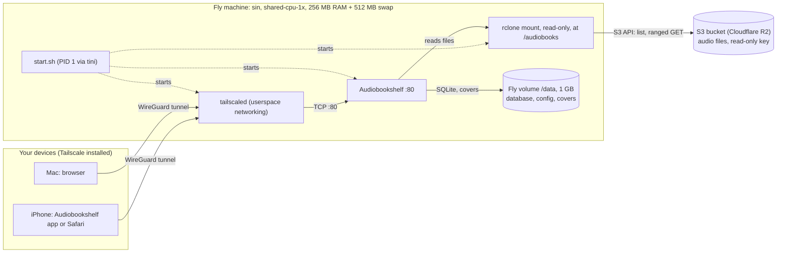
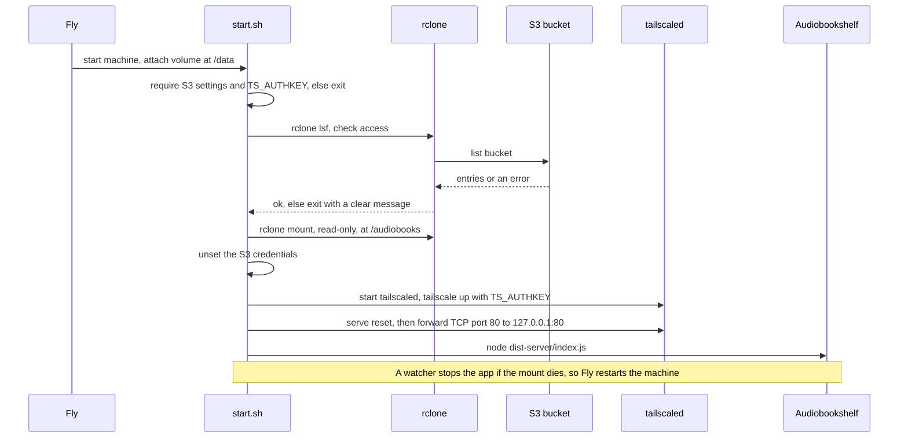
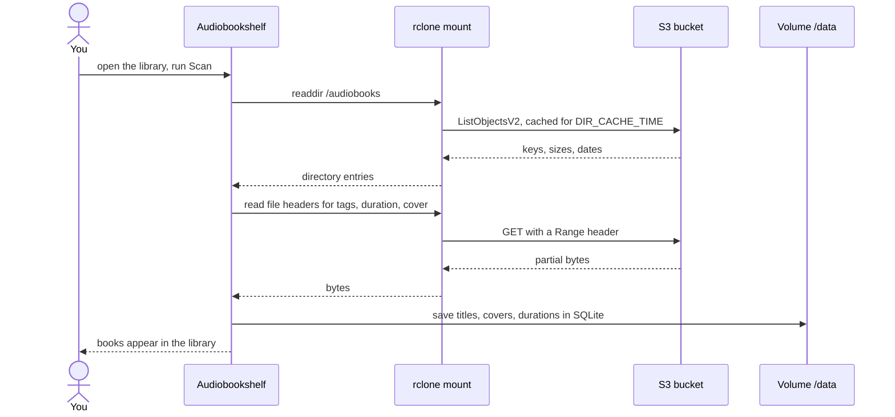
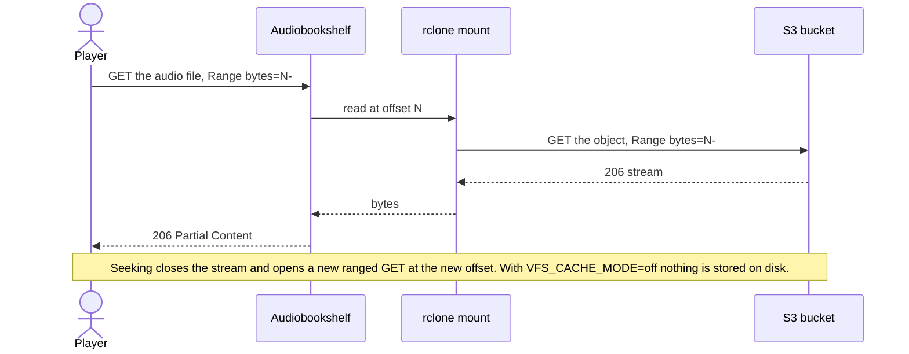

# Audiobookshelf on Fly.io with audiobooks in S3-compatible storage

This repo wraps the public [Audiobookshelf](https://github.com/advplyr/audiobookshelf) image so that:

- **Audiobooks stay in S3-compatible storage** (Cloudflare R2, Backblaze B2, Tigris, AWS S3, MinIO, ...). Nothing is copied at startup.
- **The bucket is mounted read-only** at `/audiobooks` with rclone FUSE. The mount acts as the link: files are fetched from the bucket when they are played. By default nothing is cached on the volume (`VFS_CACHE_MODE=off`).
- **Metadata and config live on one Fly volume** at `/data` (Audiobookshelf's database, covers, and settings).
- **The app is private.** It has no public address and is reachable only over your Tailscale network.

## How it works

```
Fly machine
├── tini                       PID 1: signal handling
└── start.sh
    ├── rclone lsf             checks the bucket, endpoint, and key before mounting
    ├── rclone mount (ro)      s3://bucket/[prefix]  ->  /audiobooks
    ├── tailscaled + serve     joins the tailnet, forwards TCP :80 to the app
    └── node dist-server/index.js   Audiobookshelf, reads /audiobooks and /data/*
```

- **Read-only.** The mount is `--read-only`, and the S3 key only needs read access. Audiobookshelf cannot modify or delete your books.
- **Fail-fast.** If the endpoint, bucket, prefix, or key is wrong, the machine exits with a clear error instead of starting with an empty library.
- **Self-healing.** If the mount dies, Audiobookshelf is stopped so Fly restarts the machine and remounts.
- **Credentials stay out of the app.** S3 secrets are unset before Audiobookshelf starts.

## Why a mount instead of syncing or symlinks

- Copying the bucket at boot would make start-up time grow with the library and need a volume as large as the whole library.
- A symlink can't point at S3 by itself. Something has to present the bucket as a filesystem, and FUSE is that layer. The mount is the single "link" for the whole bucket, so no per-file links are needed.
- Lazy reads give fast restarts, and the volume holds only the database, config, and covers.

## System design

### Architecture



The machine has no public service and no public IP. The only way in is the Tailscale tunnel.

### Startup



### Library scan



### Playback and seeking



The request shapes above are typical, not captured logs.

### Where data lives

| Data | Location | Survives a redeploy |
|---|---|---|
| Audio files | S3 bucket, read-only | Yes, never copied |
| Database, config, covers | Fly volume `abs_data` at `/data` | Yes |
| Tailscale node identity | Fly volume, `/data/tailscale` | Yes |
| Swap | Separate device, 512 MB | Not needed |
| S3 and Tailscale secrets | Fly secrets | Yes |

## Deploy to Fly.io

### 1. Create the bucket and a read-only key

Create a bucket (for example `audiobooks`) with a folder layout Audiobookshelf understands:

```
audiobooks/
  Author Name/
    Book Title/
      01.m4b
      cover.jpg
```

Create an access key that can **read and list only that bucket**. Settings for each provider are in the table below.

### 2. Create the app and volume

```sh
fly launch --copy-config --no-deploy     # keeps this fly.toml; choose a unique app name
fly volumes create abs_data --region sin --size 1   # use the same region as primary_region; 1 GB is enough, see Sizing
```

### 3. Set the S3 secrets

```sh
fly secrets set \
  S3_ENDPOINT="https://<account-id>.r2.cloudflarestorage.com" \
  S3_BUCKET="audiobooks" \
  S3_ACCESS_KEY_ID="..." \
  S3_SECRET_ACCESS_KEY="..."
```

Set `S3_PROVIDER` and `S3_REGION` in `fly.toml` to match your provider (table below). Add `S3_PREFIX` as a secret or in `fly.toml` if you only want one folder of the bucket.

### 4. Deploy

```sh
fly deploy
```

**Redeploys keep your data.** The database, config, and covers live on the `abs_data` volume, and `fly deploy` reattaches that same volume to the new machine. Only these actions remove data: `fly volumes destroy`, `fly apps destroy`, or changing `source` in `[[mounts]]` (which creates a new, empty volume). Don't run `fly launch` again on an existing app, since it can create a new app and volume. Audio is never on the volume, so it isn't affected either way.

The app has no public address, so open it from a device on your tailnet at `http://audiobookshelf` (or the hostname you set in `TS_HOSTNAME`). Create the admin user, then add a library:

- **Folder:** `/audiobooks`
- **Watch for changes:** off, if your version shows this option. Changes in S3 don't generate filesystem events, so use **Scan** instead.
- **Store metadata with item:** off, if your version shows this option. Keep metadata on the volume, because `/audiobooks` is read-only.

Re-run **Scan** after you upload new books to the bucket.

### Provider settings

| Provider | `S3_PROVIDER` | `S3_ENDPOINT` | `S3_REGION` |
|---|---|---|---|
| Cloudflare R2 | `Cloudflare` | `https://<account-id>.r2.cloudflarestorage.com` | `auto` |
| Backblaze B2 (S3 API) | `Other` | `https://s3.<region>.backblazeb2.com` | `<region>`, e.g. `us-west-004` |
| Tigris (Fly's S3) | `Other` | `https://fly.storage.tigris.dev` | `auto` |
| AWS S3 | `AWS` | `https://s3.<region>.amazonaws.com` | `<region>` |
| MinIO / other | `Minio` or `Other` | your endpoint URL | `us-east-1` or your region |

Use the read-only key for each provider: R2 "Object Read" token, B2 application key limited to the bucket with read-only capabilities, or an IAM policy with `s3:GetObject` and `s3:ListBucket`.

## Configuration

Set these as Fly secrets (credentials) or in `fly.toml` `[env]` (everything else).

| Variable | Required | Default | Purpose |
|---|---|---|---|
| `S3_ENDPOINT` | yes | | S3 API endpoint URL |
| `S3_BUCKET` | yes | | Bucket name |
| `S3_ACCESS_KEY_ID` | yes | | Read-only key ID (secret) |
| `S3_SECRET_ACCESS_KEY` | yes | | Read-only key secret (secret) |
| `S3_PROVIDER` | no | `Other` | rclone provider name (see table) |
| `S3_REGION` | no | `auto` | Region |
| `S3_PREFIX` | no | (bucket root) | Mount only this folder of the bucket |
| `MOUNT_POINT` | no | `/audiobooks` | Where the bucket appears |
| `VFS_CACHE_MODE` | no | `off` | `off` streams audio from S3 and stores nothing on the volume. `full` caches whole files on the volume (uses volume space) |
| `VFS_CACHE_MAX_SIZE` | no | `5G` | Cache size cap. Only used when `VFS_CACHE_MODE=full` |
| `DIR_CACHE_TIME` | no | `5m` | How long directory listings are cached before re-reading the bucket |
| `CACHE_DIR` | no | `/data/rclone-cache` | Cache location (on the volume) |
| `CONFIG_PATH` | (set in image) | `/data/config` | Audiobookshelf config |
| `METADATA_PATH` | (set in image) | `/data/metadata` | Audiobookshelf metadata and covers |

Sizing: with `VFS_CACHE_MODE=off` the volume holds only Audiobookshelf's database, config, and cover images. Audio files stay in S3. In testing, the database, config, and metadata used about 0.5 MB. `initial_size = "1gb"` in `fly.toml` leaves plenty of room for a large library's covers. Volumes can be extended later with `fly volumes extend`, but they can't be shrunk, so start small.

## Private access with Tailscale

The Fly app has no public service. Only devices signed in to your tailnet can reach it. Tailscale runs inside the same container, and `start.sh` refuses to start without a key.

1. **Create an auth key.** In the Tailscale admin console, go to Settings → Keys → Generate auth key. A single-use key is enough, because the machine keeps its identity on the volume (`/data/tailscale`) and redeploys reuse it.
2. **Store the key as a Fly secret.** Don't put it in the repo, `fly.toml`, the Dockerfile, or GitHub. Run `fly secrets set TS_AUTHKEY=tskey-auth-...` once. Fly keeps it and passes it to the machine on every deploy.
3. **Deploy:** `fly deploy`.
4. **Connect a device.** Install Tailscale on your phone or laptop, sign in to the same tailnet, and open `http://audiobookshelf` (or your `TS_HOSTNAME`).

With the device disconnected from the tailnet, the app is unreachable from the internet.

Checks:
- `fly logs` should show `tailnet: reachable as http://audiobookshelf`.
- If the key is expired or already used, `start.sh` exits with `tailscale up failed`. Create a new key and run `fly secrets set` again.
- Memory: tailscaled adds to the 256 MB limit. After the first deploy, watch for restarts with `fly status` and for out-of-memory messages in `fly logs`.

## Test locally first

The compose file runs an rclone S3 server as a stand-in bucket, so you can test without cloud credentials or cost.

```sh
mkdir -p local-bucket/audiobooks/"Author One"/"Book A"
cp some-book.m4b local-bucket/audiobooks/"Author One"/"Book A"/01.m4b
docker compose up --build
```

Then open http://localhost:8080 and add `/audiobooks` as a library. Local testing needs Docker with FUSE access, which the compose file grants with `/dev/fuse`, `SYS_ADMIN`, and `apparmor:unconfined`.

## Checks before going live

1. **FUSE on Fly.** After the first deploy, confirm the device exists and the mount works:
   ```sh
   fly ssh console -C "ls -l /dev/fuse"
   fly logs    # look for: [start] mounted /audiobooks
   ```
   If `/dev/fuse` is missing or the mount fails on Fly, the wrapper exits with a clear error. The fallback is to sync the bucket to the volume instead, which is slower to start and needs a volume as large as the library.
2. **Image pins.** `fly.toml` pins `ghcr.io/advplyr/audiobookshelf:2.19.0` and `rclone/rclone:1.76.0`. Before you upgrade Audiobookshelf, check its start command against the new image:
   ```sh
   docker inspect ghcr.io/advplyr/audiobookshelf:<tag> --format '{{json .Config.Entrypoint}} {{json .Config.Cmd}}'
   ```
   If the Cmd differs from `["node","index.js"]` (run from `/`), update the `CMD` line in the Dockerfile.
3. **Base image OS.** The Dockerfile installs `fuse3`, `tini`, and `ca-certificates` with `apk` or `apt-get`, whichever the base image has. It fails the build on any other base image.

## Operational notes

- **One machine.** The volume is attached to a single machine, and Audiobookshelf uses an SQLite database, so don't scale beyond one machine.
- **`auto_stop_machines` is off** so playback isn't interrupted. Set it to `"stop"` in `fly.toml` and `min_machines_running = 0` if you want to save money when idle, at the cost of a cold start.
- **Cache behaviour.** The default `VFS_CACHE_MODE=off` streams every play from S3, so no audio is stored on the volume. This costs more S3 requests and bandwidth. Set `full` only if you want played books cached on the volume, and then size the volume to fit `VFS_CACHE_MAX_SIZE`.
- **Reads from S3 cost money** on some providers (per request on S3, per download on B2 beyond the free tier). Cloudflare R2 has no egress fees.
- **Updates.** Add new books to the bucket, then run **Scan** in Audiobookshelf. Directory listings are cached for `DIR_CACHE_TIME`, so new folders can take up to that long to appear.

## Files

| File | Purpose |
|---|---|
| `Dockerfile` | Builds Audiobookshelf + rclone + FUSE + tini |
| `start.sh` | Checks S3 access, mounts the bucket read-only, runs Audiobookshelf, handles shutdown |
| `fly.toml` | Fly app config: volume, env, HTTP service, VM size |
| `docker-compose.yml` | Local test rig with an rclone S3 stand-in |
| `.dockerignore` | Keeps secrets and git data out of the image |
