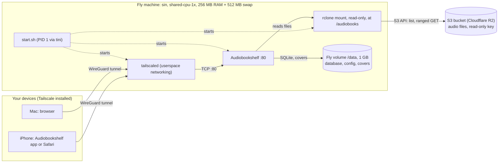
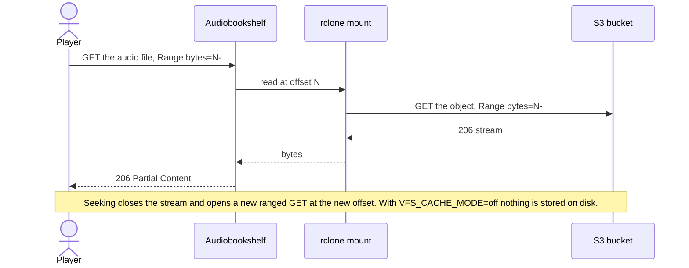

# Audiobookshelf on Fly.io, with audiobooks in S3

This repo runs [Audiobookshelf](https://github.com/advplyr/audiobookshelf) on a small Fly.io machine. Your audiobooks stay in an S3 bucket and are never copied to the server. The app is private: only devices on your Tailscale network can open it.

## How it fits together

- **Audio stays in S3.** The bucket is mounted read-only at `/audiobooks`, so Audiobookshelf reads files as if they were on disk. Audio is streamed from S3 when played and is not stored on the server.
- **The server keeps only small files.** Audiobookshelf's database, settings, and cover images live on a 1 GB Fly volume at `/data`.
- **Access is private.** The app has no public address. Tailscale runs in the same container, and you reach the app through your tailnet.

```
Fly machine
├── tini                              process manager (PID 1)
└── start.sh
    ├── rclone lsf                    checks the bucket, endpoint, and key
    ├── rclone mount (read-only)      S3 bucket  ->  /audiobooks
    ├── tailscaled + serve            joins your tailnet, forwards port 80 to the app
    └── node dist-server/index.js     Audiobookshelf
```

### Why a mount instead of copying or symlinks

- **Copying the bucket at boot** would make startup slower as the library grows, and the volume would need to be as large as the whole library.
- **A symlink can't point at S3 on its own.** Something has to present the bucket as a filesystem. FUSE does that, so one mount covers the whole bucket and no per-file links are needed.
- **A mount starts fast.** Files are fetched only when they are read, and the volume holds only the database and covers.

### Safety

- **Read-only.** The mount is read-only and the S3 key only needs read access. Audiobookshelf can't change or delete your books.
- **Fail-fast.** If the endpoint, bucket, prefix, or key is wrong, the machine exits with a clear error instead of starting with an empty library.
- **Self-healing.** If the mount dies, Audiobookshelf stops, and Fly restarts the machine.
- **Secrets stay out of the app.** S3 credentials are removed from the environment before Audiobookshelf starts.

## Architecture



The machine has no public service and no public IP address. The only way in is through the Tailscale tunnel.

## Playback and seeking



The request shapes above are typical, not captured logs.

## Where data lives

| Data | Where | Kept across redeploys? |
|---|---|---|
| Audio files | S3 bucket, read-only | Yes. Never copied. |
| Database, settings, covers | Fly volume `abs_data`, mounted at `/data` | Yes |
| Tailscale machine identity | Fly volume, `/data/tailscale` | Yes |
| Swap | Separate device, 512 MB | Not needed |
| S3 and Tailscale secrets | Fly secrets | Yes |

## Deploy to Fly.io

### 1. Prepare the bucket and a read-only key

Create a bucket (for example `audiobooks`) and arrange books by author and title:

```
audiobooks/
  Author Name/
    Book Title/
      01.m4b
      cover.jpg
```

Create an access key that can **read and list only that bucket**. The table under [Provider settings](#provider-settings) shows how to do this for each provider.

### 2. Create the app and volume

```sh
fly launch --copy-config --no-deploy     # keeps this fly.toml; choose a unique app name
fly volumes create abs_data --region sin --size 1   # same region as primary_region
```

One gigabyte is the smallest volume Fly offers, and it's plenty for the database and covers.

### 3. Set the S3 secrets

```sh
fly secrets set \
  S3_ENDPOINT="https://<account-id>.r2.cloudflarestorage.com" \
  S3_BUCKET="audiobooks" \
  S3_ACCESS_KEY_ID="..." \
  S3_SECRET_ACCESS_KEY="..."
```

Set `S3_PROVIDER` and `S3_REGION` in `fly.toml` to match your provider. To mount only one folder of the bucket, set `S3_PREFIX`.

### 4. Set up Tailscale, then deploy

Follow [Private access with Tailscale](#private-access-with-tailscale) first, then run:

```sh
fly deploy
```

### 5. Create the admin account and add a library

Open the app from a device on your tailnet (see [Private access](#private-access-with-tailscale)). Create the admin account, then add a library:

- **Folder:** `/audiobooks`
- **Watch for changes:** off, if your version shows this option. Changes in S3 don't trigger filesystem events, so use **Scan** instead.
- **Store metadata with item:** off, if your version shows this option. Metadata has to stay on the volume, because `/audiobooks` is read-only.

Run **Scan** again after you upload new books to the bucket.

### Redeploys keep your data

The database, settings, and covers live on the `abs_data` volume, and `fly deploy` reattaches that same volume to the new machine. Only these actions delete data:

- `fly volumes destroy`
- `fly apps destroy`
- changing `source` in `[[mounts]]`, which creates a new, empty volume

Don't run `fly launch` again on an existing app, because it can create a new app and volume.

### Provider settings

| Provider | `S3_PROVIDER` | `S3_ENDPOINT` | `S3_REGION` |
|---|---|---|---|
| Cloudflare R2 | `Cloudflare` | `https://<account-id>.r2.cloudflarestorage.com` | `auto` |
| Backblaze B2 (S3 API) | `Other` | `https://s3.<region>.backblazeb2.com` | `<region>`, for example `us-west-004` |
| Tigris (Fly's S3) | `Other` | `https://fly.storage.tigris.dev` | `auto` |
| AWS S3 | `AWS` | `https://s3.<region>.amazonaws.com` | `<region>` |
| MinIO or other | `Minio` or `Other` | your endpoint URL | `us-east-1` or your region |

Use a read-only key:
- **Cloudflare R2:** an "Object Read" token.
- **Backblaze B2:** an application key limited to the bucket, with read-only capabilities.
- **AWS:** an IAM policy with `s3:GetObject` and `s3:ListBucket`.

## Private access with Tailscale

Only devices signed in to your tailnet can reach the app. `start.sh` refuses to start without a Tailscale key, so the app never runs unreachable.

1. **Create an auth key.** In the Tailscale admin console, go to **Settings → Keys → Generate auth key**. A single-use key is enough. The machine keeps its identity on the volume (`/data/tailscale`), so redeploys reuse it.
2. **Store the key as a Fly secret.** Don't put it in the repo, `fly.toml`, the Dockerfile, or GitHub:
   ```sh
   fly secrets set TS_AUTHKEY=tskey-auth-...
   ```
3. **Connect a device.** Install Tailscale on your phone or laptop, sign in to the same tailnet, and keep it connected.
4. **Open the app** at the machine's MagicDNS name, for example `http://audiobookshelf.<your-tailnet>.ts.net/`. If the name doesn't resolve on a device, use the machine's Tailscale IP address (`tailscale status` lists it).

With Tailscale disconnected, the app can't be reached from the internet.

**Checks:**
- `fly logs` should show `tailnet: reachable as http://audiobookshelf`.
- If the key is expired or already used, `start.sh` exits with `tailscale up failed`. Create a new key and run `fly secrets set TS_AUTHKEY=...` again.

## Configuration

Set credentials as Fly secrets. Set everything else in `fly.toml` under `[env]`.

| Variable | Required | Default | What it does |
|---|---|---|---|
| `S3_ENDPOINT` | yes | | S3 API endpoint URL |
| `S3_BUCKET` | yes | | Bucket name |
| `S3_ACCESS_KEY_ID` | yes | | Read-only key ID (secret) |
| `S3_SECRET_ACCESS_KEY` | yes | | Read-only key secret (secret) |
| `TS_AUTHKEY` | yes | | Tailscale auth key (secret) |
| `TS_HOSTNAME` | no | `audiobookshelf` | Machine name on your tailnet |
| `S3_PROVIDER` | no | `Other` | rclone provider name (see the table above) |
| `S3_REGION` | no | `auto` | Region |
| `S3_PREFIX` | no | (bucket root) | Mount only this folder of the bucket |
| `MOUNT_POINT` | no | `/audiobooks` | Where the bucket appears |
| `VFS_CACHE_MODE` | no | `off` | `off` streams audio from S3 and stores nothing on the volume. `full` caches played files on the volume |
| `VFS_CACHE_MAX_SIZE` | no | `5G` | Cache size cap. Only used when `VFS_CACHE_MODE=full` |
| `DIR_CACHE_TIME` | no | `5m` | How long directory listings are cached before rereading the bucket |
| `CACHE_DIR` | no | `/data/rclone-cache` | Cache location, on the volume |

Set in the image, you don't need to change these: `CONFIG_PATH=/data/config` and `METADATA_PATH=/data/metadata`.

**Sizing.** With `VFS_CACHE_MODE=off`, the volume holds only the database, settings, and covers. In testing, that was about 0.5 MB. A 1 GB volume leaves plenty of room. Volumes can grow with `fly volumes extend` but can't shrink, so start small.

## Test locally first

The compose file runs an rclone S3 server as a stand-in bucket, so you can test without cloud accounts.

```sh
mkdir -p local-bucket/audiobooks/"Author One"/"Book A"
cp some-book.m4b local-bucket/audiobooks/"Author One"/"Book A"/01.m4b
docker compose up --build
```

Open http://localhost:8080 and add `/audiobooks` as a library. Local testing needs Docker with FUSE access. The compose file grants it with `/dev/fuse`, `SYS_ADMIN`, and `apparmor:unconfined`.

## Checks before going live

1. **FUSE on Fly.** After the first deploy, confirm the device exists and the mount works:
   ```sh
   fly ssh console -C "ls -l /dev/fuse"
   fly logs    # look for: [start] mounted /audiobooks
   ```
   If the mount fails, the startup script exits with a clear error. The fallback is to sync the bucket to the volume, which is slower to start and needs a volume as large as the library.
2. **Image versions.** `fly.toml` pins Audiobookshelf 2.37.2 and rclone 1.76.0. The Dockerfile pins Tailscale 1.104.4. Before you upgrade Audiobookshelf, check its start command against the new image:
   ```sh
   docker inspect ghcr.io/advplyr/audiobookshelf:<tag> --format '{{json .Config.Entrypoint}} {{json .Config.Cmd}} {{json .Config.WorkingDir}}'
   ```
   The Dockerfile's `CMD` must match. On 2.37.2 it is `["node", "dist-server/index.js"]`, run from `/app`. On 2.19.0 it was `["node", "index.js"]`, run from `/`.
3. **Base image OS.** The Dockerfile installs `fuse3`, `tini`, and `ca-certificates` with `apk` or `apt-get`. It fails the build on any other base image.
4. **Swap.** `swap_size_mb` must be a top-level key in `fly.toml`. Inside `[[vm]]`, Fly ignores it without an error. After a deploy, check the machine with `fly ssh console -C "free -m"`.

## Operations

- **One machine only.** The volume attaches to a single machine, and Audiobookshelf uses SQLite, so don't scale beyond one machine.
- **The machine stays on.** `min_machines_running = 1` and `auto_stop_machines = "off"` keep playback from being interrupted. To save money when idle, set `auto_stop_machines = "stop"` and `min_machines_running = 0`, at the cost of a cold start.
- **Cache behavior.** With the default `VFS_CACHE_MODE=off`, every play streams from S3, so no audio is stored on the volume. This uses more S3 requests and bandwidth. Set `full` only if you want played books cached on the volume, and size the volume to fit `VFS_CACHE_MAX_SIZE`.
- **S3 charges.** Some providers charge per request or per download. Cloudflare R2 has no egress fees.
- **Adding books.** Upload new books to the bucket, then run **Scan** in Audiobookshelf. Directory listings are cached for `DIR_CACHE_TIME`, so new folders can take up to that long to appear.

## Files

| File | Purpose |
|---|---|
| `Dockerfile` | Builds Audiobookshelf with rclone, FUSE, tini, and Tailscale |
| `start.sh` | Checks S3 access, mounts the bucket read-only, starts Tailscale, runs Audiobookshelf, handles shutdown |
| `fly.toml` | Fly app config: region, volume, environment, VM size, and swap |
| `docker-compose.yml` | Local test setup with an rclone S3 stand-in |
| `.env.example` | Template for the environment variables. Copy to `.env` (git-ignored) |
| `.github/workflows/docker-build.yml` | CI: lints `start.sh` and smoke-tests the image |
| `AGENTS.md` | Guidance for AI agents working in this repo |
| `.dockerignore` | Keeps secrets and git data out of the image |
